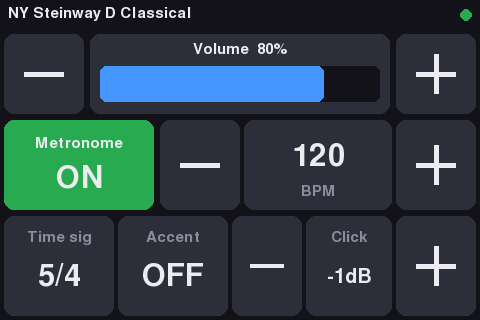

# pianoteq-touch

A big-button touchscreen remote for a headless Pianoteq on a Raspberry Pi with a
3.5" 480×320 SPI LCD (MHS-3.5" / ILI9486 + XPT2046/ADS7846 touch).

It talks to Pianoteq's JSON-RPC server, using the same calls as
[remote-for-pianoteq](https://github.com/shuhaowu/remote-for-pianoteq):

| Control | RPC |
|---|---|
| Volume −/+ (hold to repeat), or tap/drag the bar | `setParameters` `{id: "volume", normalized_value}` |
| Metronome ON/OFF | `setMetronome {enabled}` |
| Tempo −/+ (Pianoteq's tempo menu steps, 40–208) | `setMetronome {bpm}` |
| Time signature (tap to cycle) | `setMetronome {timesig}` |
| Accent on first beat | `setMetronome {accentuate}` |
| Click volume −/+ (mute, −35 … +20 dB) | `setMetronome {volume_db}` |

The display re-reads Pianoteq every 2 s, so changes made elsewhere (web remote,
MIDI) show up. The top line shows the current preset, with a green or red
connection dot.

**Shutdown** (top right) asks for confirmation, blanks the LCD and runs
`systemctl poweroff`. That works without sudo when the user has an active
console session, as with autologin + `startx`. Check with
`busctl call org.freedesktop.login1 /org/freedesktop/login1 org.freedesktop.login1.Manager CanPowerOff`,
which should print `"yes"`. To use a different command, pass `--shutdown-cmd`,
e.g. `--shutdown-cmd "sudo -n /sbin/poweroff"`; `--shutdown-cmd ""` hides the
button. Under X the app keeps its black window up until X stops, so the panel
is left black rather than showing the desktop after power-off.

The same dialog has **Exit app**, which quits back to the X desktop. To start
the app again, double-click the *Pianoteq Touch* desktop icon (see below), run
`systemctl --user start pianoteq-touch`, or reboot.



## Install

```bash
sudo apt install python3-pygame python3-numpy python3-evdev fonts-dejavu-core
```

Clone the repo on the Pi. The unit files expect it in `~/github/pianoteq-touch`:

```bash
mkdir -p ~/github && cd ~/github
git clone https://github.com/dpwe/pianoteq-touch.git
```

To update later:

```bash
cd ~/github/pianoteq-touch && git pull
systemctl --user restart pianoteq-touch
```

Pianoteq must be running with its JSON-RPC server enabled. By default it listens
on `127.0.0.1:8081`:

```bash
"Pianoteq 9" --headless --serve ""
```

## Display modes

- **`--backend fb`** (default when no X/Wayland is running): draws directly to
  the LCD's framebuffer and reads the touch panel with evdev. Use this on a
  console-only / Lite install. It picks the framebuffer that is 480×320
  automatically; override with `--fbdev /dev/fb1`. If your framebuffer is in
  portrait (320×480), add `--rotate 90` (or `270`).
- **`--backend window --fullscreen`**: use this if the LCD runs an X desktop
  (as with the goodtft `LCD-show` scripts). X handles touch for you, so you
  don't need to calibrate.

## First run: touch calibration (fb mode)

Run this once from an SSH session:

```bash
python3 pianoteq_touch.py --calibrate
```

Tap the three crosshairs. The result is saved in `~/.config/pianoteq-touch.json`,
along with any `--rotate` setting. If no calibration has been saved yet, the
program runs this step on its own. If taps land in the wrong place, run
`--calibrate` again.

You need read/write access to `/dev/fb*` and `/dev/input/event*`. Either be in
the `video` and `input` groups (`sudo usermod -aG video,input pi`, then log in
again) or run the program with sudo. If you run it as root, the calibration file
goes in `/root/.config`.

## Start on boot

**If the LCD runs an X desktop** (LCD-show + autologin + `startx`), use the
user-level unit. It needs no sudo and runs fullscreen on `:0`, using X's
existing touch calibration. Change `--pianoteq-port` in the unit if Pianoteq
isn't on 8080.

```bash
cp pianoteq-touch-x11.service ~/.config/systemd/user/pianoteq-touch.service
systemctl --user daemon-reload
systemctl --user enable --now pianoteq-touch
loginctl enable-linger $USER     # once, so it starts at boot
# Desktop icon to bring the app back after "Exit app":
cp pianoteq-touch.desktop ~/Desktop/ && chmod +x ~/Desktop/pianoteq-touch.desktop
```

If you change the unit file after a `git pull`, copy it again and run
`systemctl --user daemon-reload`.

**Console-only (framebuffer mode):**

```bash
sudo cp pianoteq-touch.service /etc/systemd/system/
sudo systemctl daemon-reload
sudo systemctl enable --now pianoteq-touch
```

Edit `User=` and the path in the unit file first if they aren't `pi` and
`/home/pi/github/pianoteq-touch`. If the service starts before you have calibrated, the
crosshairs appear on the LCD and you can calibrate there.

### Stop the console from drawing over the screen

If the Linux text console is also mapped to the LCD, its cursor or a login prompt
can show through. The app hides the cursor and redraws every 5 s, but a
cleaner fix is to keep the console on HDMI: add `fbcon=map:0` to
`/boot/firmware/cmdline.txt`, or disable the getty with
`sudo systemctl disable getty@tty1`.

## Options

```
--pianoteq-host 127.0.0.1   --pianoteq-port 8081
--backend auto|fb|window    --fullscreen
--fbdev /dev/fbN            --touchdev /dev/input/eventN
--rotate 0|90|180|270       --calibrate
--shutdown-cmd "systemctl poweroff"
```

Press Esc or q to quit in window mode.

## License

MIT. See [LICENSE](LICENSE).
